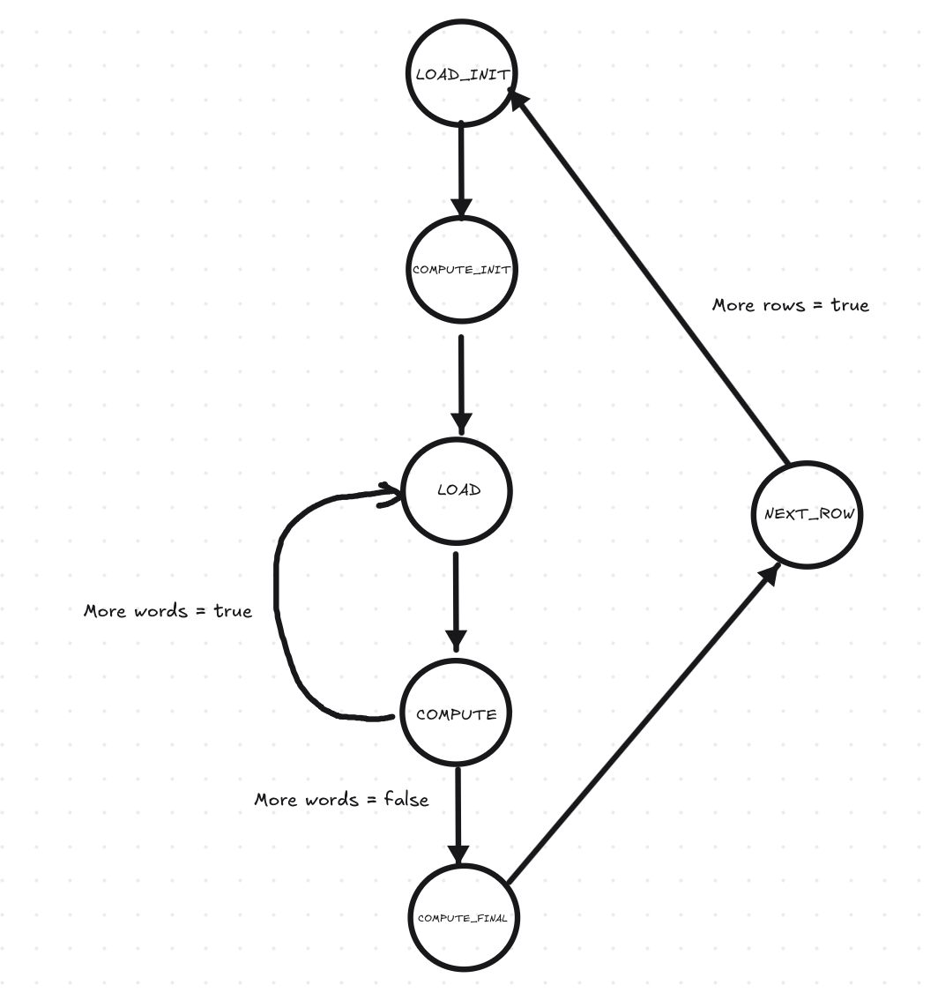
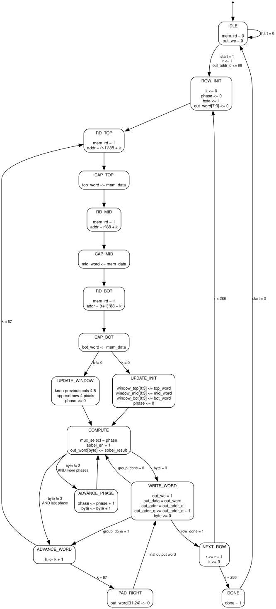

# assignment 2 report notes

## Compute Loop

The part of the ASM/FSM that does the compute can be done in a loop fashion. Instead of loading all the 9 pixels around to output a single pixel we can leverage the fact that each memory read reads a word. Each pixel is 8 bits and each word is 32 bits. Loading a buffer word returns pixels $a,b,c,d$ all from the same row. The first 88 words are the first row, the second 88 the second row and so on and so forth.

$\begin{matrix}
a&b&c&d\\
e&f&g&h\\
i&j&k&l
\end{matrix}$

To load this we need to load $w_0$, $w_{88}$ and $w_{176}$.

From here, if we ignore the boundry for now, we can calculate the Sobel operator value for $f$ and $g$.

Then if we keep the last two bytes of each word and load three more words $w_1$, $w_{89}$ and $w_{177}$, we get:

$\begin{matrix}
c&d&m&n&o&p\\
g&h&q&r&s&t\\
k&l&u&v&w&x
\end{matrix}$

from where we can calculate the Sobel operator value for $h$, $q$, $r$, and $s$.

This process can then be repeated horizontally across the row. At each iteration, the last two pixels from each of the three current words are retained, and the next word from each row is loaded. Since each new word contributes four new pixels, each subsequent iteration allows four new output pixels to be computed.

The loop continues until the final word of the current row is reached. Since each row contains $(88)$ buffer words, the horizontal word index ranges from $(0)$ to $(87)$. Special handling is required at the left and right image boundaries, since pixels in columns $(0)$ and $(351)$ do not have a complete $(3\times3)$ neighborhood.

After finishing one output row, the processing window is moved down by one row and the same procedure is repeated. For an output row $(r)$, the three input rows required are $(r-1)$, $(r)$, and $(r+1)$. Therefore, if the current horizontal word index is $(k)$, the three buffer addresses are

$
(r-1)\cdot88+k,\qquad r\cdot88+k,\qquad (r+1)\cdot88+k.
$

The valid Sobel center rows are therefore $(1)$ through $(286)$, while rows $(0)$ and $(287)$ must be handled as image boundaries.

We can have states = ```{LOAD_INIT, COMPUTE_INIT, LOAD, COMPUTE, COMPUTE_FINAL, NEXT_ROW}```, for example.

Then an FSM could look like:



> After further though we don't need the compute final part of the FSM since the last group also allows us to output $4$ pixels.

At the hardware level, the design can be divided into a datapath, which stores and processes the pixels, and an FSM, which controls when registers are updated, memory is accessed, and results are written. The more detailed FSM below makes these operations explicit.

The sliding window requires three rows of six pixels, giving $18$ $8$-bit registers, or $144$ bits of storage. After the first three memory words have been loaded, only the first four positions in each window row contain valid pixels. This allows the two initial output pixels to be computed. For each subsequent group, the last two pixels from the previous group are retained and four new pixels are appended to each row. A multiplexer selects the appropriate $3\times3$ neighborhood from this $3\times6$ window for the Sobel datapath.

The registers needed to implement the FSM are:

| Register | Width | Purpose |
| --- | --- | --- |
| `window_top`, `window_mid`, `window_bot` | $6\times8$ bits each | Store the three rows of the sliding window. |
| `top_word`, `mid_word`, `bot_word` | $32$ bits each | Hold the three words read from memory before updating the window. |
| `r` | $9$ bits | Store the current output row; valid interior rows are $1$ through $286$. |
| `k` | $7$ bits | Store the input word index within a row, from $0$ through $87$. |
| `phase` | $2$ bits | Select one of up to four Sobel neighborhoods in the current window. |
| `byte` | $2$ bits | Select the byte position in the output word. |
| `out_word` | $32$ bits | Pack four $8$-bit output pixels into one memory word. |
| `out_addr_q` | $15$ bits | Store the output word address relative to the start of the output image. |
| `state` | $5$ bits with binary encoding | Store one of the $17$ FSM states shown below. |

The input and output images each contain $88\times288=25344$ words, so a relative word address requires $15$ bits. The input word address is generated from `r` and `k`, using $(r-1)\cdot88+k$, $r\cdot88+k$, or $(r+1)\cdot88+k$ depending on which window row is being loaded.

The `phase` and `byte` counters have different purposes and must be kept separate. `phase` selects the neighborhood being processed, while `byte` selects where its result is stored in `out_word`. Initially, column $0$ is padded with zero, so `byte` starts at $1$. The first group then produces columns $1$ and $2$, leaving the output word partially filled. The next group produces columns $3$ through $6$: its first result completes the previous output word, while its remaining results begin the next word. Therefore, the output buffer must retain partially assembled words across window updates.

The memory read enable `mem_rd` and output write enable `out_we` can be decoded directly from the current FSM state. They do not require dedicated storage unless the memory interface requires registered control signals. `mem_rd` is asserted in the three read states, and `out_we` is asserted in `WRITE_WORD`. Similarly, `sobel_en` is asserted in `COMPUTE`, and `done` is asserted in `DONE`. Register load enables and multiplexer selections are also generated by the controller.

The refined set of states is:

```text
{IDLE, ROW_INIT,
 RD_TOP, CAP_TOP, RD_MID, CAP_MID, RD_BOT, CAP_BOT,
 UPDATE_INIT, UPDATE_WINDOW, COMPUTE, WRITE_WORD,
 ADVANCE_PHASE, ADVANCE_WORD, PAD_RIGHT, NEXT_ROW, DONE}
```

Their roles are as follows:

- `IDLE` waits for `start`. Processing begins with `r = 1` and `out_addr_q = 88`, corresponding to the first word of output row $1$.
- `ROW_INIT` resets `k` and `phase`, sets `byte = 1`, and clears the first output byte to pad the left boundary.
- `RD_TOP`, `RD_MID`, and `RD_BOT` issue the three memory reads. Their corresponding `CAP_*` states capture the returned words.
- `UPDATE_INIT` loads the first four pixels of each window row when `k = 0`. `UPDATE_WINDOW` retains positions $4$ and $5$ from the previous window and appends the four new pixels when `k` is nonzero. Both reset `phase` for the next group.
- `COMPUTE` selects the neighborhood indicated by `phase`, enables the Sobel datapath, and stores its $8$-bit result in the output byte selected by `byte`.
- `ADVANCE_PHASE` advances the neighborhood and output byte positions when more results remain in the current group.
- `WRITE_WORD` writes a completed output word and increments `out_addr_q`. Processing then continues with the remaining neighborhoods, the next input word, or the next row.
- `ADVANCE_WORD` advances to the next input word after a group is complete. The initial group produces two pixels, and each subsequent group produces four.
- `PAD_RIGHT` sets the final output byte to zero for column $351$, allowing the last output word of the row to be written.
- `NEXT_ROW` advances the output row and returns to `ROW_INIT` while another interior row remains. `DONE` signals completion after row $286$ has been processed.

The conditions `group_done` and `row_done` can be derived from the counters and state. The last phase is $1$ for the initial group and $3$ for later groups. When computation resumes after `WRITE_WORD`, `phase` must advance if the group is incomplete, and `byte` must restart at $0$. Likewise, `byte` must advance when a group ends without filling the output word. These updates must be made explicit in the implementation. The last-row decision must use the row just completed, so incrementing `r` in `NEXT_ROW` does not skip row $286$. Finally, padding the first and last image rows requires separate initialization or additional control states, since the illustrated loop only writes rows $1$ through $286$.



The following section was generated by an **LLM**
The handshake:

1. CPU ↔ wrapper: The CPU fills the input buffer and writes DATA_READY = 1 into the control/status register.
2. Wrapper ↔ your accelerator: The wrapper clears DATA_READY, sets BUSY, and sends your module a one-clock start pulse.
3. Your accelerator processes the image and writes the output buffer.
4. After the final output write, your module sends a one-clock finish pulse.
5. The wrapper clears BUSY and sets DONE. DONE stays high until the CPU requests another run, so the CPU can detect completion by polling.

The memory timing

Your accelerator accesses the buffers directly. There is no per-read request/acknowledge handshake:

| Operation | What your accelerator does | When it happens |
|---|---|---|
| Read input | Assert ibuf_rd_en and present a word address | Data becomes available after the next rising edge |
| Write output | Assert obuf_wr_en with address and data | Memory stores the word at the rising edge |

These timings are specified in pixel_acc.sv (src/rtl/pixel_acc.sv:7).

For your RD_TOP → CAP_TOP sequence, with outputs decoded combinationally from the state:

- During RD_TOP, drive the read enable and address.
- At the edge entering CAP_TOP, BRAM updates its output.
- During CAP_TOP, that output is valid.
- At the edge leaving CAP_TOP, capture it into top_word.

That matches the supplied synchronous memory. Registering the read controls inside always_ff changes their timing, so the implementation must account for that.

What matches, and what needs fixing

The three read/capture pairs, window-update states, separate output buffer, and WRITE_WORD state all fit the interface. The following details need correction or explicit definition:

| FSM detail | Assessment |
|---|---|
| IDLE waits for start | Correct. Ignore new starts while processing. |
| DONE asserts done = 1 | Rename the output to finish, and make DONE last exactly one cycle before returning unconditionally to IDLE. |
| WRITE_WORD → COMPUTE | When the group is incomplete, advance phase and reset byte to zero. The FSM currently only shows the byte reset. |
| Group ends with a partially filled output word | Advance byte before processing the next group. The FSM’s ADVANCE_WORD currently only increments k. |
| group_done and row_done branches | Define mutually exclusive conditions or explicit priority. Final-row-word completion must take priority. |
| Final input word | Process k = 87 fully before padding column 351. Test the current processed k before incrementing it. |
| Final output row | Complete r = 286, then finish. Test the current row before incrementing it. |

The byte-counter issue matters immediately. The first group computes columns 1 and 2 into output bytes 1 and 2. The next group’s first result, column 3, must go into byte 3. Without advancing byte between groups, it overwrites column 2.

There is also a boundary-policy decision. The assignment permits skipping boundary calculations. Your FSM instead preserves the original image layout and writes zero into the left and right boundary columns. That is a reasonable layout for the supplied infrastructure, but you must also write the first and last output rows if you want a complete image with a zero border. The BRAM contents are not reset, so leaving those rows unwritten gives undefined or stale pixels. This zero border is separate from the optional boundary-copying Sobel calculation described in the assignment.
